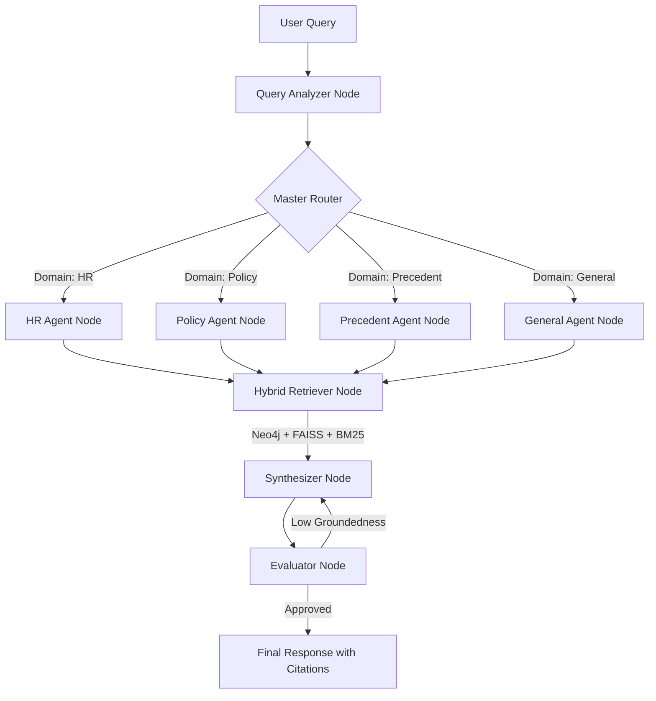

# Enterprise Knowledge Assistant

## Overview
The **Enterprise Knowledge Assistant** is an advanced Decision Intelligence Platform designed to automate enterprise research, semantic search, and evidence-grounded decision support across multiple business functions.

By leveraging a multi-agent **LangGraph** architecture, the platform securely parses domain-specific queries and retrieves verifiable data using a hybrid **GraphRAG** approach (Neo4j for relationships, FAISS for dense vector similarity, and BM25 for lexical search). 

## Key Features
- **Multi-Agent Architecture:** Specialized agents for distinct enterprise domains, including:
  - **HR Agent:** Tailored for resume parsing, candidate skill validation, and recruitment pipeline analysis.
  - **Policy Auditor:** Reviews corporate policies for compliance and answers employee queries.
  - **Precedent Validator:** Searches historical project data to validate new proposals based on past outcomes.
- **100% Traceable Citations:** All generated responses are grounded in the source data. The system guarantees traceable document IDs (e.g., `[DocID: HR-101]`) for every factual claim.
- **Hybrid GraphRAG Retrieval:** Fuses Neo4j Knowledge Graphs with FAISS vector similarity to understand both the *relationships* between entities and their *semantic meaning*.
- **GenAI Evaluation Pipeline:** Built-in reflection nodes evaluate the generated responses for groundedness and citation accuracy before delivering them to the user.
- **Modern Tech Stack:** 
  - **Backend:** Python, FastAPI, LangGraph, LangChain, Neo4j, FAISS
  - **Frontend:** Next.js (App Router), Tailwind CSS, TypeScript
  - **Infrastructure:** Docker & Docker Compose

## Architecture Flow

The system employs a deterministic state graph to route queries and validate responses:



## Getting Started

### Prerequisites
- Docker and Docker Compose installed.
- (Optional) Local Python 3.10+ and Node.js 20+ environments if running without Docker.

### Running with Docker Compose
The easiest way to run the entire stack is via Docker:

```bash
docker-compose up --build
```

This will spin up three services:
1. **Frontend (Next.js):** `http://localhost:3000`
2. **Backend (FastAPI):** `http://localhost:8000`
3. **Graph Database (Neo4j):** `http://localhost:7474` (Bolt: 7687)

### Local Development

**Backend API:**
```bash
cd backend
python -m venv venv
source venv/bin/activate  # Or venv\Scripts\activate on Windows
pip install -r requirements.txt
uvicorn main:app --reload
```

**Frontend UI:**
```bash
cd frontend
npm install
npm run dev
```

## Testing
To ensure the Multi-Agent routing is functioning correctly, you can run the backend unit tests:
```bash
cd backend
pytest test_graph.py
```
