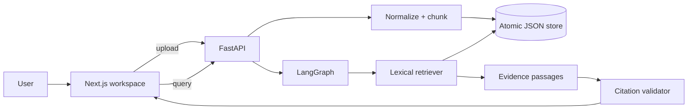

# Knowwise — Enterprise Knowledge Assistant

Knowwise is an evidence-first internal knowledge assistant. A user indexes a
UTF-8 text or Markdown document, asks a question, and receives a deterministic
retrieval result with inspectable passages and stable citation IDs. The
application is intentionally small enough to run offline and explain in an
engineering interview.

## What is implemented

- FastAPI API for document upload, listing, deletion, health, readiness, and
  querying.
- Deterministic normalization, SHA-256 content metadata, paragraph-aware
  chunking, and stable `document_id#chunk-N` citations.
- A persisted, atomic JSON document store and a lexical retriever that works
  without API keys or network access.
- LangGraph orchestration for query classification, retrieval, synthesis, and
  citation validation.
- Explicit abstention when no indexed passage matches a query.
- Next.js workspace UI with real document loading, upload states, answer
  states, source cards, expandable evidence passages, and failure states.
- Docker Compose with a persisted data volume, backend health checks, CORS
  configuration, and `npm ci`/pinned backend dependencies.
- GitHub Actions CI for backend tests and frontend lint, typecheck, and build.

## Honest scope and trade-offs

The current release supports `.txt`, `.md`, and `.markdown` only. It does not
claim PDF extraction, vector embeddings, BM25, Neo4j GraphRAG, authentication,
multi-tenant permissions, or LLM-generated synthesis. The answer is extractive
and built from retrieved passages, which makes citation integrity testable.

This is a deliberate first release: a reliable vertical slice is more useful
than a diagram that advertises infrastructure the code does not use. The next
production-oriented steps would be a real database/index, PDF extraction,
authentication and document-level ACL filtering, then an embedding/BM25
comparison backed by a versioned evaluation set.

## Architecture



## Prerequisites

- Docker Engine with Compose, or
- Python 3.10.8 (pinned in `backend/.python-version`) and Node.js 20.x
  (the frontend image uses Node 20; `.nvmrc` pins 20.19.0).

No API keys are required for the tested local flow.

## Run with Docker Compose

```bash
cp .env.example .env
docker compose up --build
```

Open:

- UI: <http://localhost:3000>
- API docs: <http://localhost:8000/docs>
- Health: <http://localhost:8000/healthz>
- Readiness: <http://localhost:8000/readyz>

Uploaded documents persist in the `knowledge_data` named volume. To reset the
demo data, run `docker compose down -v` and start again. The API is the only
service exposed besides the UI; no unused database port is published.

For a non-local deployment, set `NEXT_PUBLIC_API_URL` to the public backend
origin before building the frontend and set `CORS_ORIGINS` to the exact UI
origin. Do not commit secrets or put secrets in `NEXT_PUBLIC_*` variables.

## Run locally

### Backend

```bash
cd backend
python -m venv .venv
# Windows PowerShell
.venv\Scripts\python.exe -m pip install -r requirements.lock
.venv\Scripts\python.exe -m uvicorn main:app --reload
# macOS/Linux: use .venv/bin/python instead
```

### Frontend

In a second terminal:

```bash
cd frontend
npm ci
npm run dev
```

The frontend reads `NEXT_PUBLIC_API_URL` at build time and defaults to
`http://localhost:8000`.

## Test and build

The repository has one reproducible test entry point:

```bash
make test
```

It runs the offline backend pytest suite, frontend ESLint, and TypeScript
typechecking. To verify the production frontend build:

```bash
make build
```

Backend tests cover deterministic ingestion, stable chunk metadata, real
retrieval, citation integrity, abstention, upload/list/delete API behavior,
invalid uploads, and health/readiness endpoints.

## API quick start

```bash
curl -F "file=@samples/handbook.md" http://localhost:8000/documents
curl http://localhost:8000/documents
curl -H "Content-Type: application/json" \
  -d '{"query":"What does the handbook require?"}' \
  http://localhost:8000/query
curl -X DELETE http://localhost:8000/documents/DOCUMENT_ID
```

The query response includes `response`, `domain`, `abstained`, `citations`,
and `evidence`. Every citation returned by the workflow must resolve to an
evidence item in the same response.

## Project layout

```text
backend/
  main.py             FastAPI routes and operational endpoints
  graph.py            LangGraph workflow and citation validation
  knowledge.py        ingestion, chunking, persistence, retrieval
  test_graph.py       offline behavior and API tests
frontend/src/app/
  page.tsx            workspace UI and API integration
  globals.css         responsive visual system
docker-compose.yml    reproducible local stack
Makefile              single test/build entry points
```

## Security and production limitations

Uploaded files are untrusted input and are currently limited to 5 MiB UTF-8
text. The demo has no authentication or workspace ACLs, so it must not be
used with confidential documents on a public deployment. Before production,
add identity-aware document ownership, retrieval-time authorization filters,
rate limits, structured request IDs, audit logging that avoids document text,
and a managed persistence/index layer with backups.

## Roadmap

1. Add PDF extraction with page-aware metadata and a fixture corpus.
2. Add an embedding index and BM25 baseline, then publish Recall@k/MRR@k
   comparisons rather than unmeasured claims.
3. Add authentication, workspace isolation, upload quotas, and prompt/
   document-injection tests.
4. Add an optional LLM synthesis provider behind a deterministic fake for CI,
   retaining the citation validator and abstention gate.
