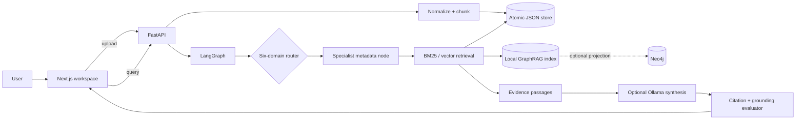

# Knowwise — Enterprise Knowledge Assistant

[](https://github.com/sidg2hp/enterprise-knowledge/actions/workflows/ci.yml)
[](https://github.com/sidg2hp/enterprise-knowledge)

Knowwise is an evidence-first internal knowledge assistant. A user indexes a
UTF-8 text or Markdown document, asks a question, and receives a deterministic
retrieval result with inspectable passages and stable citation IDs. The
application is intentionally small enough to run offline and explain in an
engineering interview.

## Current project status

| Area | Current status |
| --- | --- |
| Local application | Working end-to-end vertical slice |
| Supported ingestion | UTF-8 `.txt`, `.md`, and `.markdown` |
| Retrieval | BM25 + local GraphRAG by default; optional vector/FAISS and Ollama embeddings |
| Answer behavior | Extractive by default; optional Ollama synthesis with evidence and abstention |
| Automated checks | Backend pytest plus frontend lint, typecheck, and build |
| Public deployment | Not currently published; run locally with Docker Compose |

## What is implemented

- FastAPI API for document upload, listing, deletion, health, readiness, and
  querying.
- Deterministic normalization, SHA-256 content metadata, paragraph-aware
  chunking, and stable `document_id#chunk-N` citations.
- A persisted, atomic JSON document store and a lexical retriever that works
  without API keys or network access.
- A real BM25 implementation plus citation-linked local GraphRAG retrieval;
  optional vector retrieval uses FAISS when
  installed, with a deterministic hash-vector fallback for offline CI.
- Optional Ollama embeddings and chat synthesis with an evidence-only prompt;
  the extractive answer path remains the safe fallback.
- LangGraph orchestration for six domains: HR, policy, precedent, finance,
  engineering, and general enterprise knowledge.
- A deterministic local graph index that extracts entities and relations from
  chunks, traverses up to two hops, and returns graph paths tied to source
  citations. The same graph can be projected to optional Neo4j using fixed
  parameterized Cypher. Graph context never replaces source-passage grounding.
- Explicit abstention when no indexed passage matches a query.
- Deterministic evaluation for Recall@k, MRR@k, citation validity,
  groundedness proxy, and abstention accuracy.
- Request-correlated JSON event logging that records metadata and hashes but
  never logs document or query text.
- Next.js workspace UI with real document loading, upload states, answer
  states, source cards, expandable evidence passages, and failure states.
- Docker Compose with a persisted data volume, backend health checks, CORS
  configuration, and `npm ci`/pinned backend dependencies.
- GitHub Actions CI for backend tests and frontend lint, typecheck, and build.

## Honest scope and trade-offs

The current release supports `.txt`, `.md`, and `.markdown` only. BM25 and the
local JSON GraphRAG index run by default offline. FAISS, Ollama, and Neo4j are
optional integrations and require their own runtime setup; CI does not depend
on them.
Authentication, document-level permissions, PDF extraction, and a measured
95% research-time reduction are not implemented or claimed. The system does
not claim 100% grounding: it validates citation resolution and reports a
deterministic lexical groundedness proxy.

This is a deliberate first release: optional integrations are real code paths,
while the default remains reproducible. The next production-oriented steps are
PDF extraction, authentication and document-level ACL filtering, a durable
multi-process index, and a larger benchmark with manually reviewed claims.

## Architecture



## Prerequisites

- Docker Engine with Compose, or
- Python 3.10.8 (pinned in `backend/.python-version`) and Node.js 20.x
  (the frontend image uses Node 20; `.nvmrc` pins 20.19.0).

No API keys are required for the tested local flow.

## Run with Docker Compose

```bash
cp .env.example .env
docker compose up --build
```

Open:

- UI: <http://localhost:3000>
- API docs: <http://localhost:8000/docs>
- Health: <http://localhost:8000/healthz>
- Readiness: <http://localhost:8000/readyz>

Uploaded documents persist in the `knowledge_data` named volume. To reset the
demo data, run `docker compose down -v` and start again. The API is the only
service exposed besides the UI; no unused database port is published.

For a non-local deployment, set `NEXT_PUBLIC_API_URL` to the public backend
origin before building the frontend and set `CORS_ORIGINS` to the exact UI
origin. Do not commit secrets or put secrets in `NEXT_PUBLIC_*` variables.

### Optional vector, Ollama, and Neo4j integrations

The default Compose stack is deliberately offline-friendly. To enable the
optional adapters, install the pinned packages in
`backend/requirements.optional.lock`, run Ollama separately, and configure
the variables in `.env.example`. Set `KNOWLEDGE_RETRIEVER_MODE=hybrid` to
combine BM25 with vector scores. If FAISS or Ollama is unavailable, the
retriever records the fallback mode instead of failing the request.

To start the optional Neo4j service in the Compose profile:

```bash
docker compose --profile graph up --build
```

Set `NEO4J_URI=bolt://neo4j:7687`, `NEO4J_USERNAME`, and `NEO4J_PASSWORD` to
match the profile's `NEO4J_AUTH` value. Neo4j is used only for read-only graph
context; the returned answer must still cite local evidence passages.

## Run locally

### Backend

```bash
cd backend
python -m venv .venv
# Windows PowerShell
.venv\Scripts\python.exe -m pip install -r requirements.lock
.venv\Scripts\python.exe -m uvicorn main:app --reload
# macOS/Linux: use .venv/bin/python instead
```

### Frontend

In a second terminal:

```bash
cd frontend
npm ci
npm run dev
```

The frontend reads `NEXT_PUBLIC_API_URL` at build time and defaults to
`http://localhost:8000`.

## Test and build

The repository has one reproducible test entry point:

```bash
make test
```

It runs the offline backend pytest suite, frontend ESLint, and TypeScript
typechecking. To verify the production frontend build:

```bash
make build
```

To run the versioned retrieval/grounding fixture and print measured metrics:

```bash
make evaluate
```

The current small fixture reports Recall@5, MRR@5, citation validity,
groundedness proxy, and abstention accuracy. These are regression signals, not
claims about production performance.

Backend tests cover deterministic ingestion, stable chunk metadata, real
retrieval, citation integrity, abstention, upload/list/delete API behavior,
invalid uploads, and health/readiness endpoints.

## API quick start

```bash
curl -F "file=@samples/handbook.md" http://localhost:8000/documents
curl http://localhost:8000/documents
curl -H "Content-Type: application/json" \
  -d '{"query":"What does the handbook require?"}' \
  http://localhost:8000/query
curl -X DELETE http://localhost:8000/documents/DOCUMENT_ID
```

The query response includes `response`, `domain`, `abstained`, `citations`,
and `evidence`. Every citation returned by the workflow must resolve to an
evidence item in the same response.

## Project layout

```text
backend/
  main.py             FastAPI routes and operational endpoints
  graph.py            LangGraph workflow and citation validation
  graph_adapter.py    optional read-only Neo4j context
  retrieval.py        BM25, vector, FAISS, and Ollama embedding adapters
  llm.py              optional Ollama grounded chat adapter
  knowledge.py        ingestion, chunking, persistence, retrieval
  evaluation.py       deterministic quality metrics
  evaluate.py         versioned offline evaluation runner
  observability.py    request-safe structured event logging
  test_graph.py       offline behavior and API tests
frontend/src/app/
  page.tsx            workspace UI and API integration
  globals.css         responsive visual system
docker-compose.yml    reproducible local stack
Makefile              single test/build entry points
```

## Security and production limitations

Uploaded files are untrusted input and are currently limited to 5 MiB UTF-8
text. The demo has no authentication or workspace ACLs, so it must not be
used with confidential documents on a public deployment. Before production,
add identity-aware document ownership, retrieval-time authorization filters,
rate limits, structured request IDs, audit logging that avoids document text,
and a managed persistence/index layer with backups.

## Roadmap

1. Add PDF extraction with page-aware metadata and expand the fixture corpus.
2. Benchmark BM25, FAISS/vector, and hybrid retrieval on 50–100 reviewed
   questions, publishing Recall@k/MRR@k comparisons.
3. Add authentication, workspace isolation, upload quotas, and prompt/
   document-injection tests.
4. Add a production persistence/index layer and a deterministic fake model for
   Ollama synthesis tests, retaining the citation validator and abstention gate.
